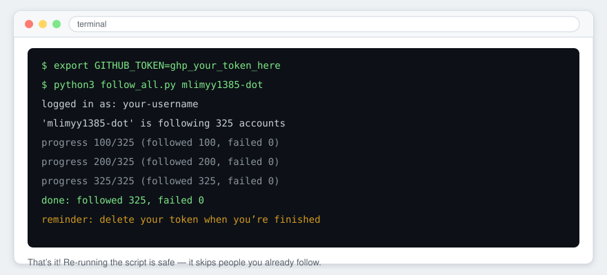
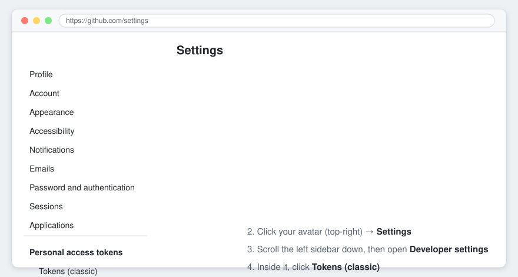
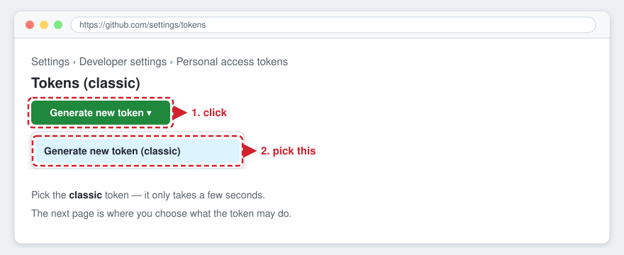
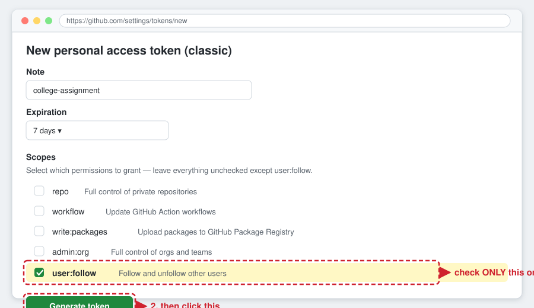
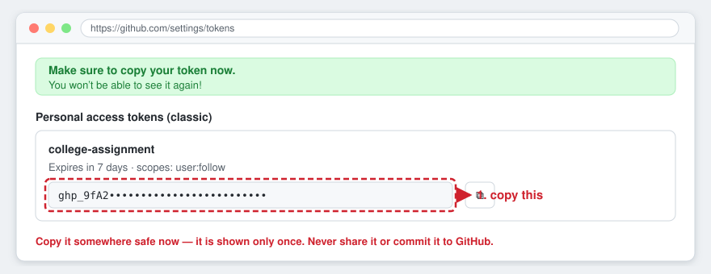

# follow-all

Follows everyone that a given GitHub profile is following — built for our
college assignment where we all need to follow the same list of classmates.

Works on Windows / macOS / Linux. Needs only Python 3 — no `pip install`.



## Setup — get your own token (2 minutes)

### Step 1 — open Developer settings

Click your avatar (top-right) → **Settings**, scroll the left sidebar down,
then click **Developer settings** → **Tokens (classic)**.



### Step 2 — start a new classic token

Click **Generate new token** → **Generate new token (classic)**.



### Step 3 — grant only the `user:follow` scope

Give it a note like `college-assignment`, and in Scopes check **only**
`user:follow` — leave everything else empty. Then click **Generate token**.



### Step 4 — copy it (shown only once!)

Copy the `ghp_...` value now — GitHub will not show it again.



## Usage

Tell the script about your token:

**macOS / Linux**
```bash
export GITHUB_TOKEN=ghp_your_token_here
```

**Windows (Command Prompt)**
```bat
set GITHUB_TOKEN=ghp_your_token_here
```

Then run it with the profile whose list you need to follow:

```bash
python3 follow_all.py mlimyy1385-dot
```

Want to see what it would do without following anyone?

```bash
python3 follow_all.py mlimyy1385-dot --dry-run
```

(Or just run the script with no token set — it will ask you for the token
with hidden input.)

## Important — token safety

- **Never** paste your token into a script, a screenshot, a chat, or commit it
  to GitHub. Anyone holding your token acts as you.
- Only grant the `user:follow` scope — nothing else.
- When you're done with the assignment, delete the token:
  **Settings → Developer settings → Personal access tokens → Delete**.
- If you ever accidentally share a token, delete it immediately and generate a
  new one.

## Notes

- Already following someone? They're just skipped — safe to run more than once.
- The script can't follow your own account; it skips it automatically.
- GitHub rate-limits how fast you can follow. If that happens the script waits
  and retries on its own, so just let it run.
